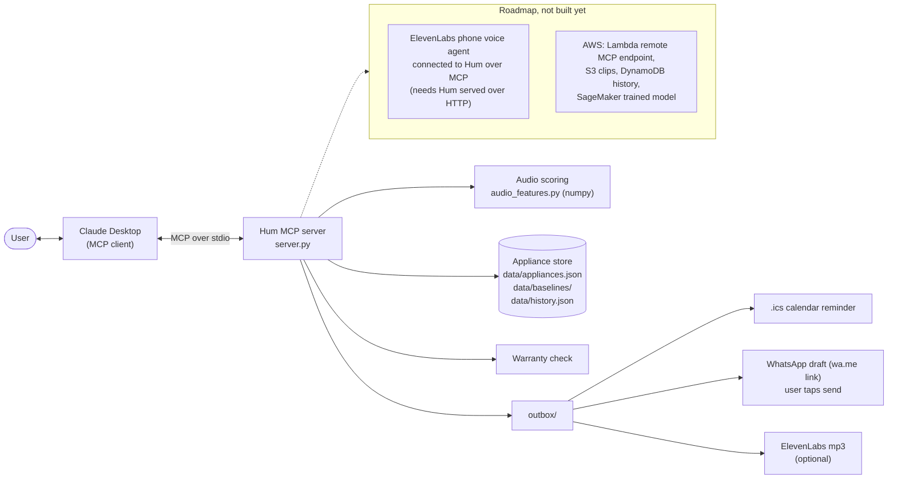

# Hum

**Every machine hums before it breaks.**

Hum is an **MCP server** that gives any MCP-capable AI assistant (we demo it in Claude Desktop) ears and hands for home appliances. Record about 10 seconds of your mixer, fan, washing machine or AC, say "it sounds weird", and Hum compares the sound with that appliance's own healthy baseline, checks the warranty, and drafts the next steps. Nothing gets written or sent until you say yes.

> Built for **wHACKiest 2026 · Track 01: Make MCP Matter** ("Less magic, more utility").
> Hum grew out of our industrial machine-health work, brought home.

---

## The problem

Washing machines, ACs, fridges, mixers, water pumps and scooters often start sounding different before they fail. Most people ignore the new noise until the machine stops. Then they lose money and days without it while they wait for a technician. Sometimes the repair would have been free under warranty, but nobody checked the purchase date.

## The solution

Ask your assistant in plain words, for example *"my mixer sounds off, check samples/mixer_faulty.wav"*. Hum then:

1. **Listens.** It compares the recording with that appliance's own healthy baseline: energy in 32 frequency bands, loudness and spectral centroid.
2. **Judges.** It returns a **health score from 0 to 100**, a level (Healthy / Watch / Get it checked), which frequency region changed (low, mid or high) and **possible causes** for that appliance type. These are possibilities, not a diagnosis.
3. **Checks the warranty.** For example: "Still under warranty until 20 Jan 2028 (about 14 months left). Call the brand's service line before paying a local technician."
4. **Acts in your apps, under your control.** It can make a calendar reminder (`.ics`), draft a WhatsApp message to your technician (a `wa.me` link) and log the reading to the appliance's history. **Every write action is preview-first**: the tool returns a draft and only commits when called with `confirm=true` after you say yes. You always press "send" in WhatsApp yourself.
5. **Speaks (optional).** If you set an ElevenLabs API key, Hum can save a spoken summary as an mp3 in English, Hindi or Tamil.

Hum is a **stethoscope, not an X-ray**. It tells you *which* appliance needs attention and *how urgently*. It does not name a broken part with certainty and it never predicts exact remaining life.

---

## Architecture



More detail in [docs/architecture.md](docs/architecture.md).

## MCP tools

| Tool | What it does | Control |
|---|---|---|
| `register_appliance(name, appliance_type, brand, model, purchase_date, warranty_months, service_number, technician_name, technician_phone)` | Saves an appliance to `data/appliances.json` | Write (local store) |
| `list_appliances()` | Lists all appliances with baseline status and latest health | Read |
| `set_baseline(audio_path, appliance)` | Builds and saves a healthy sound profile from a recording | Write (local store) |
| `scan_appliance(audio_path, appliance)` | Scores a recording against the appliance's own baseline. Without one, it falls back to a generic reference (bundled for `mixer` only) with a warning; other types are asked to run `set_baseline` first. Returns health, level, changed region, possible causes and a recommended action, and logs the reading | Read + logs history |
| `get_history(appliance)` | Past readings with dates and a trend (improving / stable / worsening) | Read |
| `check_warranty(appliance)` | Days left or expired, the brand service number and advice | Read |
| `create_reminder(title, date_iso, notes, confirm=False)` | Preview first. With `confirm=True` it writes a valid `.ics` file to `outbox/` and also returns a Google Calendar link | Preview → confirm |
| `draft_technician_message(appliance, confirm=False)` | Builds a polite message and a `https://wa.me/<phone>?text=...` link. With `confirm=True` it saves the approved draft to `outbox/`. You still tap send in WhatsApp | Preview → confirm |
| `speak_summary(text, language="en")` | Optional. If `ELEVENLABS_API_KEY` is set, calls ElevenLabs TTS (`eleven_multilingual_v2`) and saves an mp3 to `outbox/`. Otherwise returns "voice disabled" | Writes mp3 only when called |

**Prompt:** `appliance_checkup` guides the assistant through scan → check warranty → propose actions → ask the user before any `confirm=True`.

**Health levels:** Healthy ≥ 75 · Watch 45–74 · Get it checked < 45.

**Health formula:** `deviation` = mean |z| of the clip's average features against the baseline; `health = clip(100 − (deviation + 0.15) × 15, 0, 100)`. The constants were tuned on the bundled synthetic samples and should be re-tuned with real recordings.

---

`verify_tools.py` runs every tool end to end on a **temporary copy** of `data/` (your real data stays clean): cold-start scan, baseline, healthy scan (91.8), faulty scan (58.2), history, warranty, reminder preview and confirm (the `.ics` is parsed), message draft and `wa.me` link. It then starts `server.py` over stdio from a different working directory and checks that all 9 tools and the prompt are listed.

Then open `%APPDATA%\Claude\claude_desktop_config.json` (Claude Desktop → Settings → Developer → Edit Config) and add the `hum` entry from [claude_desktop_config.example.json](claude_desktop_config.example.json), using the **absolute** path to `server.py` on your machine:

```json
{
  "mcpServers": {
    "hum": {
      "command": "python",
      "args": ["C:\\Users\\you\\hum\\server.py"],
      "env": { "ELEVENLABS_API_KEY": "" }
    }
  }
}
```

If `python` is not on your PATH, use the full path to `python.exe` as `command`. **Fully quit Claude Desktop** (right-click the tray icon → Quit; closing the window is not enough) and start it again. The Hum tools then appear under the tools/connectors menu in the chat box.

### macOS

```bash
git clone <this-repo-url> hum && cd hum
python3 -m pip install -r requirements.txt
python3 make_samples.py
python3 verify_tools.py
```

Edit `~/Library/Application Support/Claude/claude_desktop_config.json`:

```json
{
  "mcpServers": {
    "hum": {
      "command": "python3",
      "args": ["/Users/you/hum/server.py"],
      "env": { "ELEVENLABS_API_KEY": "" }
    }
  }
}
```

Quit Claude Desktop with ⌘Q and reopen it.

### Optional: environment variables

- `HUM_DATA_DIR` / `HUM_OUTBOX_DIR` move the data and outbox folders (the defaults are `data/` and `outbox/` next to `server.py`).

### Optional: voice replies (ElevenLabs)

Put your key in the `env` block of the config above (`"ELEVENLABS_API_KEY": "your-key"`). Keys are read from the environment only and are never stored in the repo. Optionally set `ELEVENLABS_VOICE_ID` to choose a voice. For Hindi or Tamil, ask Claude to write the summary in that language; Hum sends it to the `eleven_multilingual_v2` model. Without a key, `speak_summary` returns "voice disabled" and everything else works.

---

## Demo script

Run these prompts in Claude Desktop, in order:

1. *"List my appliances."* → Kitchen Mixer and Washing Machine (seed data).
2. *"Set the baseline for Kitchen Mixer using samples/mixer_healthy.wav."*
3. *"Scan Kitchen Mixer with samples/mixer_healthy_2.wav."* → health 91.8, Healthy (verified).
4. *"My mixer sounds off, check samples/mixer_faulty.wav."* → health 58.2, Watch (verified), mostly a high-frequency change, with possible causes for a mixer.
5. *"Is it still under warranty?"* → yes, until 2028-01-20 (about 14 months), call the brand service number first. (The Washing Machine's warranty ended 2025-06-15.)
6. *"Remind me to call the service centre on Saturday."* → reminder **preview**. Say *"yes"* → `.ics` saved in `outbox/`, plus a Google Calendar link.
7. *"Draft a message to my technician."* → message **preview** with a WhatsApp link. Say *"yes"* → saved in `outbox/`. Open the link and press send yourself.
8. *"Show the mixer's history."* → readings with a worsening trend.
9. (Optional, needs a key) *"Say that summary in Tamil."* → mp3 in `outbox/`.

Tip: if Claude cannot find a sample, give the full path, for example `C:\Users\you\hum\samples\mixer_faulty.wav`.

## The demo samples are synthetic

`samples/*.wav` are generated by `make_samples.py`: a motor tone with harmonics and mild noise (healthy), plus intermittent high-frequency squeal and rattle bursts (faulty). They exist so the demo runs anywhere. **Replace them with real recordings** for a meaningful test:

- Use a table fan or mixer. Record it running normally, then with a pen lightly touching the blade guard (fan) or with the lid slightly loose (mixer).
- Record about 10 seconds, phone 10–20 cm from the appliance, **the same spot and the same setting each time**, in a quiet room.
- Convert to 16-bit PCM WAV (for example `ffmpeg -i clip.m4a -ac 1 -ar 16000 -sample_fmt s16 clip.wav`). If you install `soundfile`, other WAV/FLAC formats also load.

## Honest limitations

- **Scoring is baseline-deviation signal processing, not a trained deep model.** It measures how far a clip is from that appliance's own healthy profile (z-scores over band energies, loudness and centroid). The roadmap adds a trained anomaly model.
- **Possible causes come from a lookup table** per appliance type and frequency region. They are possibilities, not a diagnosis.
- **No remaining-life prediction.** Hum never says "3 weeks left".
- **Cold start.** Accuracy is best with a baseline recorded when the appliance is new or just serviced. Without a baseline, Hum compares against a generic reference for the appliance type and says the result is less accurate. Only a synthetic `mixer` reference ships today (`data/references/mixer.json`, built by `make_samples.py` with a wider tolerance); other types without a baseline are asked to record one first.
- **Recording conditions matter.** Background noise, a different phone position or a different speed setting can move the score. Record the same way every time.
- **False alarms and misses are possible.** Hum helps you decide whether to get something checked; it does not replace a technician.
- Technician and brand service numbers in the seed data are **placeholders**.
- Tested with Claude Desktop. The phone and voice client is on the roadmap, not built.

## Roadmap

- **Voice on the phone (ElevenLabs):** an ElevenLabs conversational agent connected to Hum as an external MCP server, with tool-approval controls, so you can just call and say "my AC is making a noise". This first needs Hum served over HTTP (ElevenLabs agents connect to MCP servers over SSE or streamable HTTP, not stdio). *Planned.*
- **Hosted on AWS:** Hum as a remote MCP endpoint on Lambda, recordings in S3, history in DynamoDB, a trained model served from SageMaker. *Planned.*
- **Trained anomaly model:** an autoencoder trained on the public MIMII industrial machine-sound dataset, plus per-appliance-type reference profiles to improve cold start. *Planned.*
- One day: walk through your home's machines in 3D in VR and see which one is humming wrong.

## Privacy

- Hum only listens to recordings you choose to give it. It never records on its own.
- Audio is processed locally by the MCP server on your machine. Appliance data, baselines and history stay in the `data/` folder on your device.
- The only network call is the optional ElevenLabs text-to-speech request, which sends the summary text (not audio) and only when you ask for it.

## Project structure

```
hum/
├── server.py            # MCP server (stdio)
├── audio_features.py    # numpy-based scoring
├── make_samples.py      # generates synthetic demo WAVs
├── verify_tools.py      # end-to-end check of every tool
├── data/                # appliances.json, baselines/, history.json, references/mixer.json
├── outbox/              # .ics files, approved drafts, mp3s
├── samples/             # demo WAVs (synthetic)
├── docs/architecture.md
└── claude_desktop_config.example.json
```

## Team

**[TEAM_NAME]** · wHACKiest 2026, Track 01

## License

[MIT](LICENSE)
