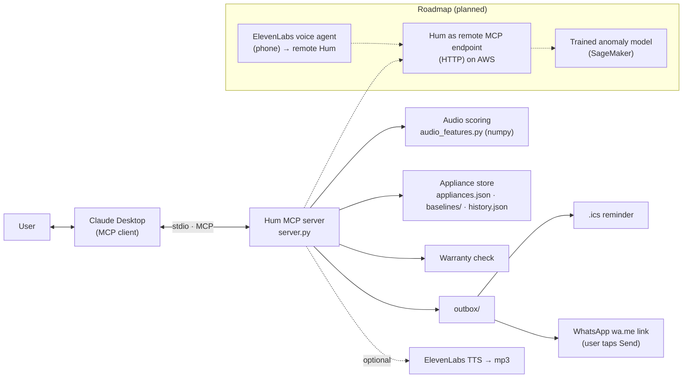

# Hum: Idea Draft

**Every machine hums before it breaks.**

wHACKiest 2026 · Track 01: *Make MCP Matter* · Team: **Boss Babies**

> **Fact-check notes on the build brief (checked 24 Nov 2026 against the sources in §17)**
>
> 1. **ElevenLabs + MCP transport.** ElevenLabs agents connect to MCP servers over **SSE or streamable HTTP**. Their MCP docs don't mention stdio. Hum as built tonight is a **stdio** server for Claude Desktop, so an ElevenLabs voice agent **cannot use it directly**. Hum first needs a hosted HTTP endpoint (the AWS roadmap item). The brief's line "ElevenLabs agents can connect to external MCP servers with tool-approval controls" is accurate. Don't read it as "plug-and-play with today's build".
> 2. **ElevenLabs MCP availability.** The ElevenLabs docs say MCP is not available to workspaces with Zero Retention Mode or HIPAA compliance enabled. This is minor, but don't promise it for every account type.
> 3. **MIMII is industrial, not household.** MIMII contains valves, pumps, fans and slide rails recorded in real factories with factory background noise. It's a good starting point for a trained anomaly model, but the model needs fine-tuning or domain adaptation before it fits home appliances. Don't say "trained on appliance sounds".
> 4. **MCP SDK version.** mcp 2.x renamed `FastMCP` to `MCPServer` (verified). The dev machine currently has **mcp 1.30.0** installed, so the dual-import shim in the brief is needed, and both paths should be tested.
> 5. **Event dates** (Nov 26–27 ideathon pitch, Dec 1–2 24-hour hack) come from the team's brief. They are not independently verified here.
>
> Verified as accurate: ElevenLabs tool-approval modes exist ("Always Ask", "Fine-Grained Tool Approval", "No Approval"). Multilingual v2 TTS lists Tamil, Hindi and English. The wa.me click-to-chat format with `?text=` pre-fill is correct. RFC 5545 is the current iCalendar standard.

**Legend used throughout:** ✅ **Built** (working in the repo tonight) · 🟡 **Optional/conditional** (built, only runs if a key is set) · 🔜 **Planned** (roadmap, not built)

---

## 1. Summary

Hum is an **MCP server** that gives any MCP-capable AI assistant ears and hands for home appliances. You record about 10 seconds of your mixer, washing machine, AC, fridge, fan or water pump, then say something like "my washing machine sounds weird." Hum then:

1. **Listens.** It compares the clip with *that appliance's own healthy baseline*. ✅
2. **Judges.** It returns a health score from 0 to 100, the frequency region that changed (low / mid / high), and *possible* common causes. These are possibilities, not a diagnosis. ✅
3. **Checks warranty.** It reports days left and the brand service number, with advice to call the brand first because the repair may be free. ✅
4. **Acts, under your control.** It drafts a calendar reminder (.ics), drafts a WhatsApp message to your technician (wa.me link) and logs the reading. Every write is **preview first and commits only after your explicit yes**. ✅
5. **Speaks.** It can give a voice summary in English, Hindi or Tamil through ElevenLabs TTS when an API key is set. 🟡

Hum is a **stethoscope, not an X-ray**: it tells you *which* appliance needs attention and *how urgently*. It does not tell you exactly which part is broken or how long the machine has left.

*Origin:* Hum grew out of our industrial machine-health work, brought home.

## 2. Problem

- Appliances such as washing machines, ACs, fridges, mixers, water pumps and scooters often start **sounding different** before they fail: a new rattle, a whine, a hum that wasn't there before.
- People notice the noise but **ignore it**. They have no easy way to tell whether it matters or how urgent it is.
- The machine then breaks at an inconvenient time. The household goes without it until a technician comes, and the repair often costs more than early attention would have.
- **The missed free repair:** many appliances are still under the manufacturer's warranty when a problem starts. Nobody checks the purchase date, and people pay a local technician for a repair the brand might have done for free.
- Today's tools don't connect these steps. Voice assistants can't hear the machine. Warranty details are on a paper bill somewhere. Technician contacts are scattered across WhatsApp.

*(We deliberately quote no statistics or ₹ figures. We have not found a checkable source for India-specific appliance failure or warranty-miss rates, and we won't invent one.)*

## 3. Target users

| User | Why Hum helps |
|---|---|
| **Households** | One place to track every noisy machine, with a nudge before it becomes a breakdown. |
| **Renters / PG residents** | A health reading and history to show the landlord ("it's been getting worse since the 3rd"), plus a polite drafted message. |
| **Elderly parents' homes** | Adult children can scan a parent's appliances when they visit. A simple Healthy / Watch / Get it checked level, voice replies in the parent's language, and a technician message ready to send. |
| **Small shops** (tea stalls, juice shops, small eateries, tailors) | The mixer, fridge or pump *is* the business. A day without it costs income, so early warning matters more. |

## 4. Solution and user journey

### Step by step

1. **Register once** (`register_appliance`, ✅). Enter the name, type, brand, model, purchase date, warranty months, brand service number and technician's name and phone.
2. **Record a healthy baseline** (`set_baseline`, ✅). Record about 10 seconds when the appliance is new or just serviced. Without a baseline, Hum uses a generic reference for that appliance type and **says the result is less accurate**. Tonight only a synthetic `mixer` reference ships; other types are asked to record a baseline first.
3. **Something sounds off.** Record 10 seconds from the same spot and ask the assistant in plain words.
4. **Scan** (`scan_appliance`, ✅). Hum returns the health score, level, changed region, possible causes and a recommended action, and logs the reading.
5. **Warranty** (`check_warranty`, ✅). Hum reports days left or expired and the brand service number.
6. **Propose actions.** The assistant offers a reminder (`create_reminder`, ✅) and a technician message (`draft_technician_message`, ✅). Both come back as **previews**.
7. **User says yes.** Only then is the tool called with `confirm=true`. That writes the .ics to `outbox/` or marks the message as approved. **The user still taps Send in WhatsApp themselves.**
8. **Optional voice** (`speak_summary`, 🟡). Hum saves an mp3 summary in English, Hindi or Tamil.
9. **Over time** (`get_history`, ✅). Hum shows the readings with dates and a trend (improving / stable / worsening).

### Sample conversation (Claude Desktop, demo)

> **User:** My mixer sounds off. Can you check `samples/mixer_faulty.wav`?
>
> **Assistant** *(calls `scan_appliance`)*: Kitchen Mixer: **Health 58/100 (Watch)**. The change is mostly in the **high-frequency** range compared with its healthy baseline (last healthy reading: 92). Possible causes for a mixer, which are *not a diagnosis*: the blade or coupler rubbing, worn motor bearings, or worn carbon brushes. I'd suggest getting it checked within a week.
>
> **User:** Is it still under warranty?
>
> **Assistant** *(calls `check_warranty`)*: Yes. About 14 months of the 24-month warranty are left. Call the brand service line first, because the repair is likely free. *(The service number in the demo data is a placeholder.)*
>
> **Assistant** *(calls `create_reminder` with `confirm=false`)*: Here's a draft reminder: "Call brand service about the mixer", tomorrow at 10:00. Should I create it?
>
> **User:** Yes.
>
> **Assistant** *(calls `create_reminder` with `confirm=true`)*: Done. `outbox/…ics` is ready to open in your calendar app. Should I also draft a WhatsApp message to your technician as a backup?
>
> **User:** Sure, show me first.
>
> **Assistant** *(calls `draft_technician_message` with `confirm=false`)*: Here's the draft and a wa.me link. Nothing is sent until you tap Send in WhatsApp.

## 5. Track fit

| Phrase from the Track 01 brief | How Hum answers it |
|---|---|
| "MCP-powered solution" | Hum *is* an MCP server: 9 tools plus 1 prompt, usable from any MCP client. ✅ |
| "a regular person would actually use every day" | Every home has noisy machines. The flow is "record 10 s and ask in plain words". ✅ |
| "intelligent agents that work with the apps … people already rely on" | Calendar (standard .ics), WhatsApp (official wa.me click-to-chat), the assistant they already use (Claude Desktop), and voice (ElevenLabs). ✅ / 🟡 |
| "services and tools" | Brand service numbers, technicians and warranty records. ✅ |
| "Go beyond basic integrations" | Hum doesn't just wrap an API. It adds sensing (audio scoring against a per-appliance baseline), memory (history and trend) and judgment (warranty-aware advice). ✅ |
| "useful" | A clear level and next step, and a warranty check that can save a paid repair. ✅ |
| "reliable" | Deterministic, explainable signal processing that gives the same input the same score. Results show which frequency region changed. Hum warns when no baseline exists. ✅ |
| "controlled interactions" | Read tools run automatically. Every write is preview → explicit yes → commit. WhatsApp messages are always sent by the user. ✅ |
| "make everyday tasks simpler" | It replaces "ignore the noise, it breaks, search for a bill, call someone blind" with one conversation. ✅ |
| "Less magic, more utility" | No black-box claims. We give a score, a region and *possible* causes, and we're honest about what we don't know. ✅ |

## 6. MCP tools and the control model

### Tools (all ✅ built unless marked)

| Tool | Type | What it does |
|---|---|---|
| `register_appliance(name, appliance_type, brand, model, purchase_date, warranty_months, service_number, technician_name, technician_phone)` | write (local store) | Saves the appliance to `data/appliances.json`. |
| `list_appliances()` | read | Lists all appliances with baseline status and latest health. |
| `set_baseline(audio_path, appliance)` | write (local store) | Builds and saves the healthy profile to `data/baselines/`. |
| `scan_appliance(audio_path, appliance)` | read + log | Returns health 0–100, level, changed region, possible causes and recommended action, and appends the reading to `data/history.json`. Falls back to a generic reference with a warning if there's no baseline (only a synthetic `mixer` reference ships; other types get an error asking for `set_baseline`). |
| `get_history(appliance)` | read | Past readings with a trend: improving / stable / worsening. |
| `check_warranty(appliance)` | read | Days left or expired, the brand service number and advice. |
| `create_reminder(title, date_iso, notes, confirm=False)` | **gated write** | Returns a preview when `confirm=False`. With `confirm=True`, writes a valid RFC 5545 `.ics` to `outbox/` and also returns a Google Calendar link. |
| `draft_technician_message(appliance, confirm=False)` | **gated write** | Returns the message text and a `https://wa.me/<phone>?text=<urlencoded>` link. `confirm=True` saves it to `outbox/` as approved. The user sends it. |
| `speak_summary(text, language="en")` 🟡 | external call | If `ELEVENLABS_API_KEY` is set, calls ElevenLabs TTS (`eleven_multilingual_v2`; optional `ELEVENLABS_VOICE_ID`) and saves an mp3 to `outbox/`. Otherwise returns "voice disabled". Keys are never hard-coded. |
| **Prompt** `appliance_checkup` | prompt | Guides the assistant: scan → check warranty → propose actions → **ask the user before any `confirm=True`**. |

### Control model

- **Read tools run automatically.** Listing, scanning, history and warranty checks change nothing outside Hum's own reading log.
- **Write tools have two phases.** The first call always returns a *draft*. The assistant shows it, the user says yes in plain words, and only then is the tool called again with `confirm=True`.
- **No silent sending.** Hum never sends a WhatsApp message, email or calendar invite. It creates a file or a link, and the human performs the final send or import.
- **Layered with the client's own controls.** Claude Desktop can ask the user to approve each tool call. Hum's preview-first design adds a second, content-level check on top of that.
- **No secrets in code.** The ElevenLabs key comes only from an environment variable.

## 7. How the scoring works and the trained-model roadmap

### Built tonight: baseline-deviation signal processing ✅

1. **Load** the audio as mono, 16 kHz, float32. Clips shorter than 1 s are rejected.
2. **Frame features.** Use 2048-sample frames with a 1024-sample hop and a Hann window. Per frame, compute:
   - **32 log-spaced band energies from 50 Hz to 8 kHz** (log10),
   - **log RMS** (loudness),
   - **spectral centroid** (kHz), which shows where the sound's "brightness" sits.
3. **Baseline profile.** Take the per-feature **mean and std** across frames of the healthy clip, with a std floor of 0.05 so a near-constant feature can't blow up the z-scores.
4. **Score a new clip.** Compute the clip's mean features, then the **z-score** of each one against the baseline, then `deviation = mean(|z|)`.
   `health = clip(100 − (deviation + 0.15) × 15, 0, 100)`. The constants were tuned on the bundled synthetic samples: a second healthy take scores **91.8** and the faulty clip **58.2** (Watch, change in the high band). They should be re-tuned on real recordings.
5. **Level:** **Healthy ≥ 75 · Watch 45–74 · Get it checked < 45.**
6. **Changed region.** Whichever of **low (< 300 Hz) / mid (300 Hz – 2 kHz) / high (> 2 kHz)** has the largest mean |z|. Hum also reports the loudness change (dB) and centroid change (Hz).
7. **Possible causes.** A lookup table by appliance type (washing_machine, mixer, ac, fridge, fan, water_pump) and region, with 2–3 common, non-alarming causes each. They're always labelled "possible causes, not a diagnosis".

**Why this approach tonight:** it's transparent, needs no training data, runs locally with only numpy, and its output can be explained in one sentence ("mostly a high-frequency change").

**Honest limits:** it isn't a trained deep model. It measures *change from this machine's normal*, not specific faults. Accuracy depends on recording conditions (see §14).

### Roadmap: a trained anomaly model 🔜

- **Autoencoder anomaly detection** following the approach of the MIMII baseline. MIMII's authors evaluated an autoencoder-based unsupervised detector on their dataset. We'd pre-train on MIMII's **fan and pump** recordings, which are closest to home appliances, then fine-tune on household recordings. MIMII is industrial, so domain adaptation is required.
- **Per-appliance-type reference profiles** built from many opt-in healthy recordings. These would improve the cold-start case where a user has no personal baseline.
- **Guided recording** that checks clip length, loudness and clipping, and prompts the user to "hold the phone in the same spot as last time".
- The baseline-deviation scorer stays as an explainable fallback and sanity check next to any learned model.

## 8. Architecture

- ✅ **Built:** stdio MCP server, local JSON store, numpy scoring, outbox files, optional ElevenLabs TTS.
- 🔜 **Planned:** everything inside the "Roadmap" box.

## 9. Sponsor integration

### ElevenLabs

| What | Status |
|---|---|
| `speak_summary` calls the ElevenLabs Text-to-Speech API with a multilingual model and saves an mp3 reply. Multilingual v2 lists **English, Hindi and Tamil** among its supported languages. | 🟡 **Built, optional.** Runs only when `ELEVENLABS_API_KEY` is set. |
| **Voice agent on the phone:** an ElevenLabs conversational agent connected to Hum as an MCP server. ElevenLabs agents support MCP servers with tool-approval modes (Always Ask / Fine-Grained / No Approval), which fits Hum's control model. | 🔜 **Planned.** ElevenLabs connects over SSE or streamable HTTP, so Hum first needs a hosted HTTP endpoint (see AWS). |

### AWS (all 🔜 planned, nothing on AWS tonight)

| Service | Role |
|---|---|
| **AWS Lambda** (or a small container service) | Host Hum as a **remote MCP endpoint over HTTP**, so phone and voice clients such as the ElevenLabs agent can reach it. |
| **Amazon S3** | Store audio clips, but only those the user opts to upload. Local-only stays the default. |
| **Amazon DynamoDB** | Appliance records, baselines and reading history for multi-device use. |
| **Amazon SageMaker** | Train and host the autoencoder anomaly model (§7). |

## 10. What's built tonight

- ✅ `server.py`: an MCP server over stdio with all 9 tools and the `appliance_checkup` prompt. It uses a dual import that works on mcp 1.x and 2.x, and resolves paths from its own folder.
- ✅ `audio_features.py`: numpy-only feature extraction and scoring. It uses `soundfile` if installed, otherwise stdlib `wave`.
- ✅ `make_samples.py`: **synthetic** demo WAVs (a healthy mixer, a second healthy take with a different noise seed, and a faulty mixer with high-frequency squeal and rattle bursts). They're clearly labelled synthetic, and real recordings should replace them.
- ✅ Seed data: "Kitchen Mixer" (in warranty) and "Washing Machine" (warranty expired), with **placeholder** technician and service numbers.
- ✅ Preview-first `.ics` reminders and WhatsApp wa.me drafts written to `outbox/`.
- ✅ `verify_tools.py`, which calls every tool on a temporary copy of `data/` (real data stays clean): cold-start scan → baseline → healthy scan (91.8) → faulty scan (58.2) → history trend (worsening) → warranty → reminder preview and confirm (.ics parses) → message draft (valid wa.me link). It also launches the server over stdio from a different working directory and checks the 9 tools and the prompt. All checks pass.
- 🟡 ElevenLabs voice summary (needs the user's own API key).
- ✅ Demo client: **Claude Desktop**. Any MCP client works.
- 🔜 Not built: phone app, ElevenLabs voice agent, AWS hosting, trained model, VR view.

## 11. Competition and alternatives

| Alternative | What it lacks |
|---|---|
| **Ignoring the noise** (the default) | No early warning. The breakdown is a surprise, and warranty status goes unchecked. |
| **Calling a technician blind** | No objective "how bad, how urgent", no history to show, and people often pay even when the warranty would cover the repair. |
| **Generic voice assistants** | They can set reminders and send messages, but they **can't hear the machine**, know nothing about this appliance's normal sound, and don't know its warranty. |
| **Enterprise machine-monitoring / predictive-maintenance tools** | Built for factories. They need installed sensors, industrial contracts and setup, and don't fit a home or small shop. |
| **Brand apps for connected appliances** | Only work for that brand's smart models, and they can't help with the many non-connected appliances in most homes. |

**Hum's edge:** it uses the phone microphone you already have, compares against *your machine's* normal sound, knows the warranty, and drafts the next step in apps you already use, without acting until you say yes.

## 12. Business model

- **Free for households.** Core scanning, history, warranty checks and drafts are free.
- **Verified-technician referrals.** Hum earns a referral fee when a user *chooses* to book a verified local technician. The user's own technician always remains an option.
- **Brand service-centre partnerships.** Brands get earlier, better-described service requests ("high-frequency change, health 58, in warranty"), which may make repairs simpler for them.
- **Extended-warranty partners.** Hum can show an offer near warranty expiry, clearly labelled as a partner offer and opt-in.
- **We don't sell user data.** Audio and appliance records aren't sold or shared for advertising. Anything shared with a partner happens only on the user's explicit request (for example, sending the reading to a technician they chose).

## 13. Privacy

- **Records only on request.** Hum never listens in the background. It only analyses a clip the user deliberately records and points it to.
- **Local processing.** In tonight's build, audio is processed **locally** by the MCP server on the user's machine using numpy. No audio leaves the device.
- **Data stays on the device.** Appliance records, baselines, history and outbox files are local JSON and text files.
- **One exception, opt-in.** If the user enables voice replies, only the **text summary** (not the audio recording) is sent to ElevenLabs to generate speech.
- **Planned cloud features** (§9) will be opt-in, with uploads limited to what the user selects.
- **Note:** the AI assistant (MCP client) sees the tool results, which include scores, causes and warranty status, so the client's own privacy policy also applies.

## 14. Risks and mitigations

| Risk | Mitigation |
|---|---|
| **Background noise** (TV, traffic, other appliances) | Guidance to record in a quiet moment. Planned: a recording-quality check. Results always show *which* region changed so odd readings can be questioned. |
| **Phone placement varies between recordings** | Guidance to use the same spot and distance as the baseline. Planned: a placement prompt that says "same spot as last time". |
| **Cold start (no baseline)** | Hum compares against a generic appliance-type reference (only a synthetic `mixer` one ships today) and **says it's less accurate**. It recommends recording a baseline after the next service. |
| **False alarms** | Three-level output (Healthy / Watch / Get it checked) rather than binary alerts. Trend over several readings. Wording is "possible causes" and "get it checked", never "broken". |
| **Missed problems** (a fault that doesn't change the sound) | Hum is a stethoscope, not an X-ray. We say so clearly. Smells, leaks, burning and electrical issues always mean turning the appliance off and calling a professional. |
| **Overtrust** | No remaining-life estimates and no certain part names. Every result carries the "not a diagnosis" label. The user decides and acts. |
| **Unwanted actions by the AI** | Preview → explicit yes → commit for every write. WhatsApp is always sent by the user. The client's per-tool approval adds another layer. |
| **Synthetic demo data** | Demo WAVs are labelled synthetic. The README explains how to record real normal-vs-faulty clips (for example a fan, normal vs a pen lightly touching the guard). |

## 15. Roadmap

| When | What |
|---|---|
| **Tonight (24 Nov 2026)** ✅ | MCP server, 9 tools and 1 prompt, numpy scoring, preview-first actions, optional ElevenLabs TTS, Claude Desktop demo, public repo. |
| **Nov 26–27, ideathon pitch** | Present Hum. Replace synthetic samples with real recordings (fan and mixer, normal vs induced fault) and show real score changes. |
| **Dec 1–2, 24-hour hack** 🔜 | Expose Hum over HTTP (remote MCP), connect an **ElevenLabs voice agent** with "Always Ask" approval, and do a first AWS deployment (Lambda + DynamoDB + S3). |
| **After** 🔜 | Train the autoencoder anomaly model (MIMII pre-training, household fine-tuning) on SageMaker. Add per-type reference profiles, guided recording and technician and brand partnerships. |
| **Future** 🔜 | Walk through your home's machines in 3D (VR). |

## 16. Q&A prep

1. **"Is this actually AI, or just an FFT?"** Tonight's scoring is deliberately simple and explainable: band-energy z-scores against your machine's own baseline. The AI part is the agent that turns that into actions you control. A trained autoencoder is next on the roadmap.
2. **"How accurate is it?"** We haven't run a formal accuracy study, so we won't quote a number. On our synthetic demo clips, a second healthy take scores high and the faulty clip drops into "Watch" (see the verification output in the repo for exact numbers). Real-world accuracy depends on placement and noise, which is why we report trends and a three-level scale.
3. **"Why not just tell me which part is broken?"** Sound alone can't identify a part reliably. We list *possible* causes per appliance and frequency region and recommend a check. Overconfident diagnosis is how people get misled.
4. **"What if I never recorded a healthy baseline?"** Hum compares against a generic reference for that appliance type and says the result is less accurate (tonight only a synthetic mixer reference exists; other types ask for a baseline). Record a baseline after the next service.
5. **"Why MCP instead of an app?"** MCP lets any assistant (Claude Desktop today, a voice agent tomorrow) use the same tools. We build the capability once and reach users through the assistants they already use.
6. **"How do you stop the AI from doing things on its own?"** Every write tool returns a draft first and only commits with `confirm=true` after the user says yes. WhatsApp messages are never sent by Hum. The user taps Send.
7. **"Where does my audio go?"** Nowhere. It's processed locally on your device. Only the optional voice feature sends the *text* summary to ElevenLabs.
8. **"How do you make money without selling data?"** Opt-in technician referrals, brand service partnerships and extended-warranty partners. We don't sell data.
9. **"What's the ElevenLabs angle?"** Voice replies in English, Hindi or Tamil work now with a key. Next is an ElevenLabs voice agent that calls Hum's tools over MCP with "Always Ask" approval, after Hum is hosted over HTTP.
10. **"What's the AWS angle?"** It's planned, not built: Lambda for a remote MCP endpoint, S3 for opt-in clips, DynamoDB for history and SageMaker for the trained model.

## 17. Sources

All links below were checked on 24 Nov 2026.

1. Purohit, H., Tanabe, R., Ichige, K., Endo, T., Nikaido, Y., Suefusa, K., Kawaguchi, Y. *MIMII Dataset: Sound Dataset for Malfunctioning Industrial Machine Investigation and Inspection.* arXiv:1909.09347 (2019); DCASE 2019 Workshop. https://arxiv.org/abs/1909.09347 (industrial valves, pumps, fans, slide rails; 16 kHz; autoencoder-based baseline evaluation)
2. MIMII Dataset on Zenodo (Hitachi, Ltd., CC BY-SA 4.0). https://zenodo.org/records/3384388
3. MIMII baseline code (autoencoder anomaly detection). https://github.com/MIMII-hitachi/mimii_baseline/
4. Model Context Protocol specification. https://modelcontextprotocol.io/specification/2025-06-18, including Tools (https://modelcontextprotocol.io/specification/2026-07-28/server/tools) and Prompts (https://modelcontextprotocol.io/specification/2025-06-18/server/prompts)
5. MCP Python SDK (official). https://github.com/modelcontextprotocol/python-sdk. The v2 rename of FastMCP to MCPServer is described in its migration guide: https://github.com/modelcontextprotocol/python-sdk/blob/main/docs/migration.md
6. ElevenLabs: *Model Context Protocol* for agents (SSE / streamable HTTP; tool approval modes; not available with Zero Retention Mode / HIPAA). https://elevenlabs.io/docs/eleven-agents/customization/tools/mcp
7. ElevenLabs: *MCP integration security* (approval mode options). https://elevenlabs.io/docs/eleven-agents/customization/tools/mcp/security
8. ElevenLabs: *Models* (Multilingual v2 language list, including Hindi and Tamil). https://elevenlabs.io/docs/overview/models
9. ElevenLabs: *Create speech* (Text-to-Speech API, `POST /v1/text-to-speech/:voice_id`). https://elevenlabs.io/docs/api-reference/text-to-speech/convert
10. WhatsApp Help Center: *How to use click to chat* (wa.me links, pre-filled `?text=`). https://faq.whatsapp.com/5913398998672934
11. IETF RFC 5545: *Internet Calendaring and Scheduling Core Object Specification (iCalendar)*, September 2009. https://datatracker.ietf.org/doc/html/rfc5545
