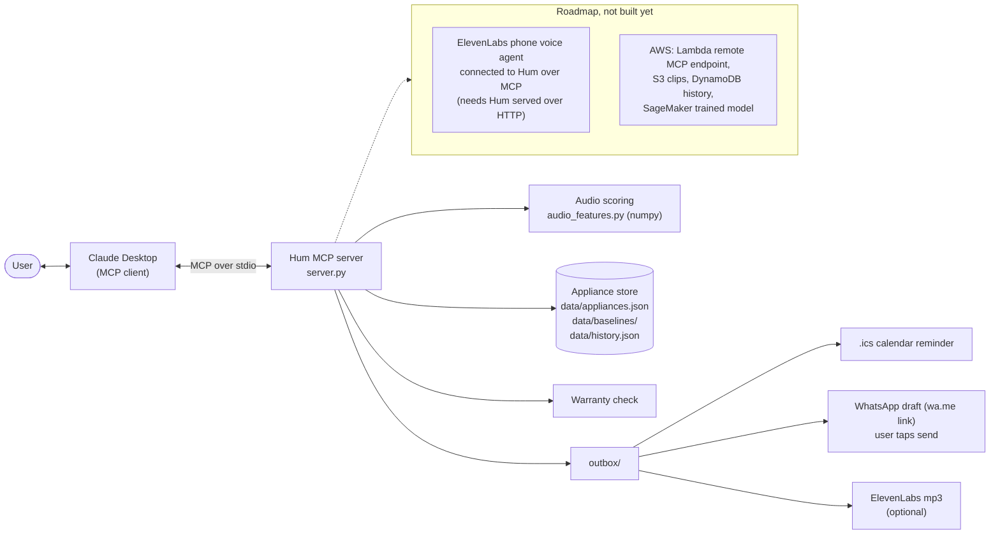

# Hum architecture

## Data flow

1. The user talks to an MCP client (Claude Desktop in the demo) and points it at a recording, for example `samples/mixer_faulty.wav`.
2. The client calls Hum's tools over stdio. Hum resolves every path relative to its own folder, so it works no matter where the client launches it from.
3. `audio_features.py` loads the clip as 16 kHz mono, splits it into 2048-sample frames (hop 1024, Hann window) and computes 32 log-spaced band energies from 50 Hz to 8 kHz, log RMS loudness and spectral centroid.
4. `set_baseline` stores the mean and standard deviation of those features as the appliance's healthy profile in `data/baselines/`.
5. `scan_appliance` z-scores a new clip against that profile. The mean absolute z-score (`deviation`) becomes a 0–100 health score: `health = clip(100 − (deviation + 0.15) × 15, 0, 100)`. On the bundled synthetic samples a second healthy take scores 91.8 and the faulty clip 58.2 (Watch, change in the high band). The region (low < 300 Hz, mid 300 Hz–2 kHz, high > 2 kHz) with the largest change picks the **possible causes** from a lookup table for that appliance type. The reading is logged to `data/history.json`.
6. `check_warranty` reads the purchase date and warranty months from `data/appliances.json`.
7. Write actions put their output in `outbox/`: `.ics` reminders, approved WhatsApp drafts and optional ElevenLabs mp3 files.

Without a baseline, `scan_appliance` falls back to a generic reference for the appliance type (only `data/references/mixer.json` ships today; it is synthetic, with standard deviations widened ×2) and warns that the result is less accurate. Other types without a baseline get an error asking for `set_baseline`.

`create_reminder` also returns a Google Calendar link. `HUM_DATA_DIR` and `HUM_OUTBOX_DIR` can relocate the data and outbox folders (used by `verify_tools.py` to test on a temporary copy).

## Control model

| Kind | Tools | Behaviour |
|---|---|---|
| Read | `list_appliances`, `get_history`, `check_warranty`, `scan_appliance` | Run when the assistant calls them. `scan_appliance` also appends the reading to the local history. |
| Local setup | `register_appliance`, `set_baseline` | Save to the local data folder when the user asks. |
| Preview → confirm | `create_reminder`, `draft_technician_message` | Called with `confirm=False` (the default) they return a draft only. The assistant shows it, the user says yes, and only then is the tool called again with `confirm=True` to write the file. |
| User-sent | WhatsApp | Hum never sends messages. It produces a `wa.me` link; the user opens it and taps send. |
| Optional network | `speak_summary` | Calls ElevenLabs TTS (`eleven_multilingual_v2`, voice from optional `ELEVENLABS_VOICE_ID`) only if `ELEVENLABS_API_KEY` is set in the environment, and only sends the text summary. |

The `appliance_checkup` prompt tells the assistant to follow this order: scan → check warranty → propose actions → ask before any `confirm=True`.
